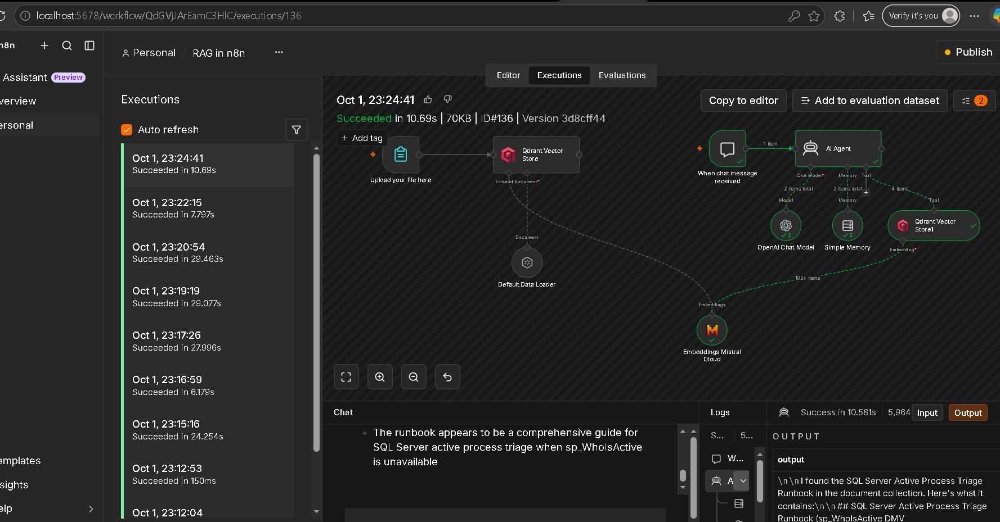
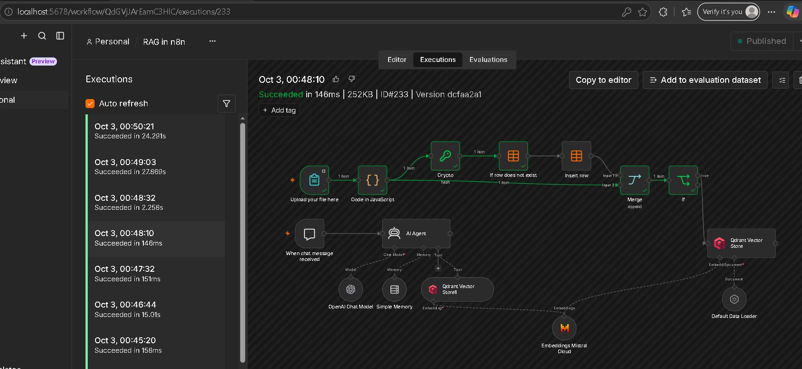
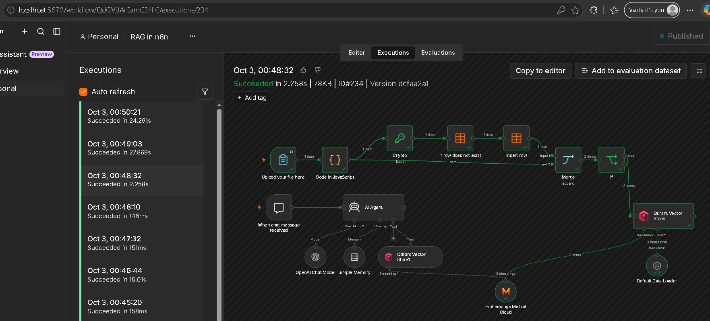
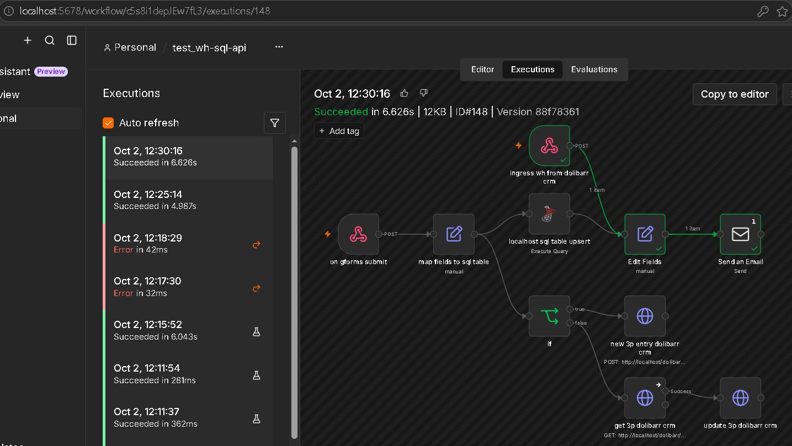
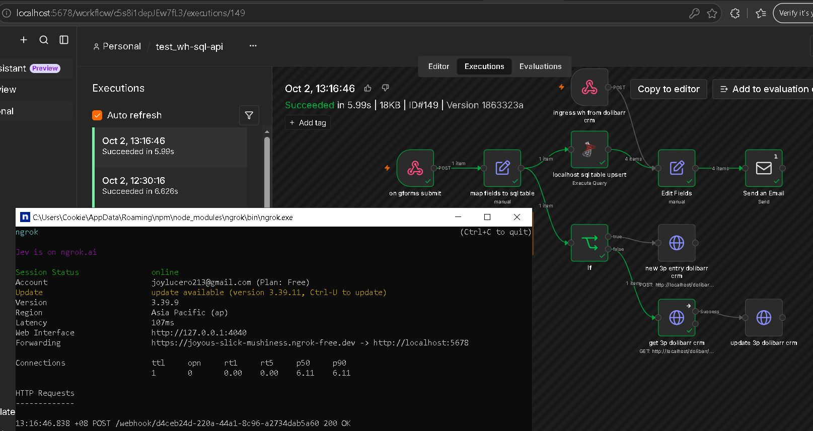

# RAG App: Powered by n8n, LLM & Qdrant 
# Integration Pipeline: Google Forms to SQL Server & CRM via n8n

## RAG App Powered by n8n, LLM &amp; Qdrant

Designed and deployed an end-to-end Retrieval-Augmented Generation (RAG) agent in n8n ⚡. The system enables users to upload custom documents, auto-indexes them into a high-performance vector store (Qdrant), and uses an AI Agent to deliver grounded, accurate answers for support, research, and internal QA. With deduped of ingested documents and prompt injection attack resistance

#### Retrieval (n8n Web Chat App)

#### Ingestion (n8n File Upload Web App)

## Integration Pipeline: Google Forms to SQL Server & CRM via n8n

Transformed a fragmented lead management process into an automated, fault-tolerant integration ecosystem using self-hosted n8n ⚡. The solution bridges raw web form inputs, a local staging database, and Dolibarr CRM, eliminating manual data entry and ensuring zero lead drop-off

#### Webhook Trigger

